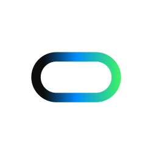

# InspoAI for Cursor



A design plugin for Cursor: generate and refine UI screens, explore website inspiration, use real brand and design-system tokens, and create animated Shades backgrounds.

This repository contains the Cursor plugin configuration and public assets. It connects to the hosted InspoAI MCP service at `https://app.inspoai.io/mcp`.

## Requirements

- Cursor with MCP and plugin support.
- An InspoAI account. Sign in with Google at [InspoAI](https://app.inspoai.io/login).
- An internet connection. Account plan limits apply to hosted tools.

## Install and connect

When this plugin is approved, install InspoAI from the Cursor Marketplace. In Cursor's Customize page, enable the InspoAI MCP server and complete the browser authorization flow. Sign in to your own InspoAI account and approve the connection.

For a manual MCP connection, add this server to your Cursor MCP configuration:

```json
{
  "mcpServers": {
    "inspoai": {
      "url": "https://app.inspoai.io/mcp"
    }
  }
}
```

Cursor discovers the server's OAuth authorization endpoints. Each user authorizes their own account; no shared API key, environment variable, or client secret is included in this plugin.

To test the complete plugin locally before marketplace publication, place the contents of this repository in a real directory named `inspoai` under `~/.cursor/plugins/local/`, reload Cursor, and inspect Customize. Follow [Cursor's local plugin instructions](https://cursor.com/docs/plugins#test-plugins-locally). Local imports must be permitted by your workspace policy.

## What you can do

| Tools | Purpose |
| --- | --- |
| `generate_ui`, `edit_ui`, `get_generation` | Generate responsive HTML screens, recreate public UI screenshots, edit screens, and retrieve results. |
| `find_website_inspiration` | Find curated website and landing-page examples. |
| `extract_brand` | Extract a website's logo, colors, fonts, and social links. |
| `list_design_systems`, `get_design_system` | Discover curated visual systems and export their tokens. |
| `search_icons` | Find icons and SVG markup. |
| `list_moodboards`, `get_moodboard`, `save_moodboard` | Read and save moodboards on the connected account. |
| `list_shader_effects`, `create_shades` | Explore templates and effects, then create Shades frames with editor links and code. |

An additional app-only tool, `upload_shades_image`, supports the image-upload controls on compatible MCP App previews.

## Example prompts

- "Use InspoAI to design a dark pricing page for a team scheduling product with three plans."
- "Show me four fintech landing-page references and use them to plan my redesign."
- "Find a light productivity design system and export its CSS tokens."
- "Create an aurora hero background in Shades using a designed template."
- "Change my generated screen to use my brand colors and preserve its content."

UI generation can take approximately 30–90 seconds. For short tool timeouts, use `generate_ui` with `wait: false`, then poll `get_generation`. Generated screens are saved to the connected user's InspoAI canvas; open the returned canvas link to review them.

Shades previews depend on the client's MCP Apps support and a compatible browser with WebGPU. If an inline preview is unavailable, use the returned editor links and code. Some effects animate only in the Shades editor.

## Data and permissions

The hosted service receives the tool arguments you choose to send, including design briefs, HTML, public image URLs, and moodboard items. Generated screens and moodboards are stored on the connected account. `save_moodboard` can create a public share link when explicitly requested with `public: true`. `create_shades` returns a share/editor link for its saved frame. Follow the tool approval prompts in Cursor.

- [Privacy policy](https://app.inspoai.io/privacy-policy)
- [Terms of service](https://app.inspoai.io/terms-of-service)
- [Support](https://app.inspoai.io/contact-us)

## Troubleshooting

- If authorization is required, reconnect the MCP server and finish the browser consent flow.
- If a quota error appears, check your InspoAI plan and monthly allowance.
- If generation is still running, poll the returned generation ID instead of starting another job.
- App-screen inspiration is not offered by this integration; use website inspiration instead.

## License

The plugin configuration and documentation in this repository are MIT licensed. The InspoAI logo is a brand asset; no trademark rights are granted. Access to the hosted InspoAI service is governed by its terms of service.
